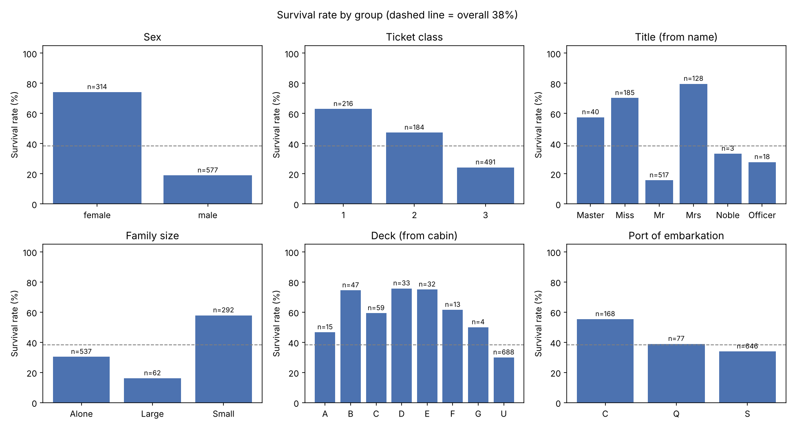
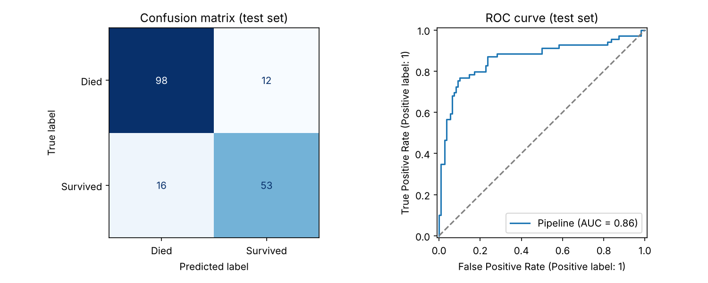
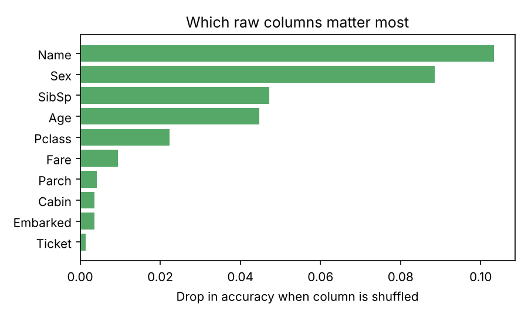

# Titanic Survival Prediction

Predicting which passengers survived the Titanic disaster from their ticket, family and demographic details, using a scikit-learn pipeline with custom feature engineering and a model comparison.

**Result:** 84.4% accuracy on a held-out test set (baseline of "everyone dies" = 61.5%), ROC-AUC 0.86.



## What the data shows

| Group | Survival rate |
|---|---|
| Women | 74% |
| Men | 19% |
| 1st class / 3rd class | 63% / 24% |
| Boys ("Master") vs adult men ("Mr") | 57% vs 16% |
| Small families (2–4) vs alone vs large (5+) | 58% vs 30% vs 16% |

"Women and children first" shows up clearly — but so does class, and so does family size.

## Approach

```
raw CSV ──► TitanicFeatures (custom transformer) ──► scaling + one-hot ──► model
```

**Feature engineering** ([`src/features.py`](src/features.py))
- **Title** extracted from the name (`Mr`, `Mrs`, `Miss`, `Master`, plus grouped rare titles). Captures sex, age group and social status in one feature.
- **Age imputation by title + class** instead of a single median — a missing-age "Master" gets a child's age, not an adult's (177 ages were missing).
- **Family size** (`SibSp + Parch + 1`) bucketed into Alone / Small / Large.
- **Ticket group size** and **fare per person** — `Fare` is the price of the whole ticket, so a family of 6 on one ticket looked "rich" without this fix.
- **Deck** from the first letter of the cabin, and a **HasCabin** flag (cabin is missing for 77%).

All of these are learned inside `fit()`, so they're computed only from the training rows during cross-validation — no information from the test fold leaks into the features.

**Modelling** ([`src/train.py`](src/train.py))
- 80/20 stratified split; the 20% test set is only used once, at the end.
- 5 models compared with **5× repeated stratified 5-fold CV** (25 scores each):

| Model | CV accuracy |
|---|---|
| Logistic Regression | 0.832 ± 0.035 |
| Gradient Boosting | 0.832 ± 0.030 |
| **Soft-voting ensemble** (LR + SVM + RF + GB) | **0.830 ± 0.034** |
| Random Forest | 0.828 ± 0.030 |
| SVM (RBF) | 0.827 ± 0.029 |
| K-Nearest Neighbours | 0.805 ± 0.027 |

The top models are within noise of each other, so the soft-voting ensemble (averages the probabilities of four different model types) is used as the final model.

**A lesson learned:** an earlier version ran a grid search on the SVM. It scored 84% in cross-validation but only 77% on the test set — with ~700 training rows, aggressive tuning was fitting noise in the folds. Switching to repeated CV and an ensemble fixed it.

## Results (held-out test set, 179 passengers)

| Metric | Score |
|---|---|
| Accuracy | 0.844 |
| Precision | 0.815 |
| Recall | 0.768 |
| F1 | 0.791 |
| ROC-AUC | 0.863 |



Permutation importance — how much accuracy drops when a column is shuffled. `Name` ranks first because the title extracted from it is the strongest single feature:



## Run it

```bash
pip install -r requirements.txt

python src/eda.py      # charts in reports/figures/
python src/train.py    # compares models, saves models/titanic_model.joblib
pytest                 # unit tests for the feature engineering

python src/predict.py --name "Smith, Mrs. Anna" --sex female --age 29 \
    --pclass 2 --sibsp 1 --parch 1 --fare 26
# Survival probability: 84.8% -> SURVIVED
```

## Project structure

```
data/train.csv            Kaggle Titanic training data (891 passengers)
src/features.py           custom sklearn transformer (feature engineering)
src/pipeline.py           model definitions + full pipeline
src/eda.py                exploratory charts
src/train.py              model comparison, evaluation, saving
src/predict.py            CLI prediction for one passenger
tests/test_features.py    unit tests
reports/                  metrics.json, model_comparison.csv, figures
```

## Data

[Kaggle — Titanic: Machine Learning from Disaster](https://www.kaggle.com/c/titanic/data) (`train.csv`).
